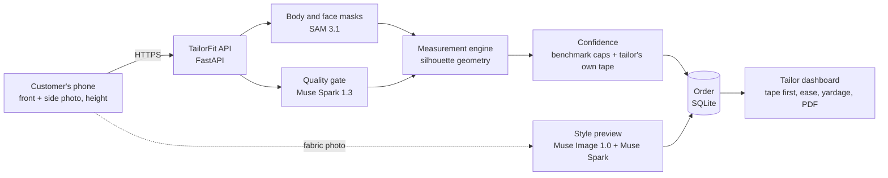

# TailorFit

A tailor sends a customer a link. The customer takes a front photo and a side photo on their own phone, types in their height, and a minute later the tailor has a twelve-measurement sheet — each number marked with how confident we actually are in it, plus the yardage and a cutting sheet ready to print.

We built this on Meta's models (SAM 3.1, Muse Spark, Muse Image) for Meta's Build for Your World hackathon, Startup track.


**Live app:** https://tailorfit-yhoi.onrender.com  
**Demo login:** `etimpaul22@gmail.com` — password is in the submission form, not here.

The demo account already has a few sample customers in it so you don't have to create one from scratch. It's on Render's free tier, so if nobody's hit it in a while the first load takes ten or twenty seconds to wake up. That's normal, not a bug.

## Why we built it

In Nigeria, and in a lot of places, made-to-measure clothing still runs on someone physically measuring you. That means a trip to the tailor, or a relative with a tape sending numbers over a WhatsApp voice note. Numbers get mixed up, a customer who's travelled can't be measured at all, and if the cloth was bought by the yard, a bad number is an expensive mistake.

There are body-measurement apps already. Most of them give you one clean, confident-looking number and let you find out at the fitting whether it was right. That's the part we didn't want to copy. A tailor can't cut from a number they don't trust, so instead of pretending to be more accurate than we are, TailorFit tells the tailor which two or three numbers are actually worth checking with a tape, and leaves the rest alone.

## What it actually does

For the tailor: add a customer, send them a private link, and watch the order fill in on its own once they've sent their photos. Every measurement shows up marked high, medium or low confidence, with a "tape these first" note pointing at the two or three numbers worth double-checking. There are thirteen styles to choose from — agbada, senator, kaftan, buba and sokoto, gown, mermaid gown, iro and buba, bubu, skirt and blouse, jumpsuit, dashiki, shirt, trousers — each with its own ease settings you can adjust, and the yardage updates live for 36, 45 or 60-inch cloth. When you're happy, print the cutting sheet.

For the customer, it's just a link opened on their phone — nothing to install. The camera tells them live when their whole body is actually in frame before it lets them take the photo, which sounds small but turns out to matter a lot. They can add a photo of their own fabric and see roughly what the finished outfit would look like in it. Faces get blurred automatically, photos are deleted right after processing unless they choose to let the tailor keep them, and they can ask for deletion at any point from their own link.

TailorFit is a tailoring workflow, not a general body analyzer. The measurements exist only so a tailor can cut cloth: there is no health, weight or body-shape output, and nothing is presented as final. The models do the seeing (masks, photo checks, previews), while the numbers come from deterministic geometry that can be tested, which is why each one carries a confidence mark and the tailor always has the last word.


A few things we think are genuinely different about this, rather than just features on a list:

The confidence marks aren't decorative. Each one is capped by how wrong that exact measurement has actually been on a benchmark we tested against, so we never call a number "high confidence" when we know it's often off by several centimetres. And it improves with use — whatever the tailor types in after checking with their own tape gets stored next to our estimate, and once a measurement has a steady bias across six or so orders, new estimates for that tailor get corrected for it automatically. The accuracy page shows this happening over time, specific to that tailor's customers, not some global average.

Returning customers are fast. A repeat order starts from whatever that customer's last numbers were (their tailor-checked ones if we have them), and if new photos come in, it shows exactly what changed.

And it's built assuming a Nigerian phone and a Nigerian network, not a lab. The camera guidance works with the phone's wide lens automatically so people don't have to back across the room to fit in frame, quality feedback is available in Pidgin as well as English, and the whole flow works over a link sent through WhatsApp.


## How it works, roughly



Muse Spark looks at each photo first and checks for the obvious problems — loose clothing, bad posture, arms pinned to the body, bad lighting, something in the way, the whole body actually being in frame, the phone being tilted — and rejects anything unusable with a plain-language reason, in English or Pidgin.

Whatever passes goes to SAM 3.1, which returns a body mask and a face mask for each photo. The face gets blurred right away, before anything is stored or shown to anyone.

From there it's geometry, not another model call: the front and side silhouettes get scaled using the height the customer typed in, and we read widths and depths at specific points on the outline — the armpit, the shoulder corner, the waist, the hip, the crotch — and turn those into girths using a cross-section shape we fitted on a public benchmark rather than assuming the body is a stack of ellipses.

Each number's confidence score folds together the mask quality, the photo verdict from Muse Spark, whether the front and side readings actually agree with each other, and that measurement's typical error on our benchmark. If the tailor has corrected this measurement before for their own customers, that correction gets applied here too.

If the customer adds a fabric photo, Muse Image draws the chosen style in that fabric, Muse Spark checks the result for reasonable body proportions before it's shown, and it's labelled "Preview, not the final garment" because it is one.

None of this needs GPU hosting. It all runs off one small server calling Meta's API.

### Which Meta model does what, and why

| Model | Used for | Why this one |
| --- | --- | --- |
| SAM 3.1 | Person and face masks per photo; live "whole body in view" hints while the customer lines up | Clean full-body masks are what the geometry actually needs, and the same call finds the face to blur |
| Muse Spark 1.3 | Photo quality gate; judging the style preview | Fast multimodal reasoning (around 3 seconds at minimal effort) is enough for a yes/no check with a reason attached |
| Muse Image 1.0 | Style preview in the customer's own fabric | Takes an edit from the customer's photo plus a fabric swatch |

## Is it actually accurate?

We've started finding out, not just benchmarked it: real people, about five so far, measured end to end through the real app. That's early, not a proper pilot yet, but it's real photos on real phones in real rooms, not clean lab silhouettes. Alongside that we have a benchmark result, and we're upfront about its limits too.

We tested against BodyM, a public dataset of body scans with front and side silhouettes, by Amazon, CC BY-NC 4.0. Six of our twelve measurements have a counterpart in it. We tuned the engine only on the 87-person Test-A split, then ran it against the 150-person Test-B split it had never seen, which is the number that matters.

Mean absolute error in centimetres, held-out Test-B, before and after the changes we made:

| Measurement | First version | Now |
| --- | --- | --- |
| Shoulder width | 6.2 | 1.9 |
| Arm round | 4.3 | 2.6 |
| Thigh | 8.8 | 5.7 |
| Waist | 8.4 | 6.0 |
| Hip | 6.7 | 6.2 |
| Bust / chest | 14.0 | 6.6 |

What actually moved those numbers, in each case found by looking at where the engine was going wrong on real images rather than guessing: when someone's arms were pressed against their torso, the silhouette merged into one shape and the arms got measured as chest — that's fixed by finding where the arms actually separate. Chest used to use the armpit row for depth, but with the arms held slightly out, the fullest part of the chest is below that row, not at it. Shoulder width had the same root problem — it was reading where the arms joined the torso outline, which keeps getting wider, instead of the actual shoulder corner. And the cross-sections are squarer than a plain ellipse now, which a real torso is.

We also ran a load test: 50 real requests at once, real models, from one laptop. All 50 came back, median response time 31 seconds, slowest 39. A single request on its own takes about 3.4 seconds.

## Privacy and security, briefly

Faces are blurred automatically and photos are processed in memory and deleted unless a customer explicitly opts in to the tailor keeping the (still face-blurred) copies. Each tailor can only see their own customers — we tested every endpoint against another tailor's orders to make sure of this, not just the ones we expected to need it. Passwords are stored as scrypt hashes, sessions are random tokens where only a hash is kept server-side, and every upload is re-encoded to strip location and device metadata before it touches disk. There's a Content-Security-Policy, cross-site request checks, and rate limits on the calls that cost money.

We're not going to pretend it's finished — the gaps we know about are listed openly in [services/api/SECURITY.md](services/api/SECURITY.md) rather than buried.

## Running it yourself

You'll need Python 3.12, Node 22, and a Meta Model API key.

```bash
git clone <this repo> && cd TailorFit
cp .env.example .env          # set MODEL_API_KEY; optionally DEMO_PASSWORD for the demo account

# Python dependencies (one virtual environment for every service)
python3.12 -m venv services/api/.venv
for f in services/*/requirements.txt eval/requirements.txt; do services/api/.venv/bin/pip install -r "$f"; done

# Node package that decodes SAM's masks
(cd services/segmentation && npm ci)

# Start
cd services/api && .venv/bin/python -m uvicorn app.main:app --host 0.0.0.0 --port 8000
```

Open `http://localhost:8000`, hit "Get started", make an account, add a customer, and open their link on your own phone. The camera needs HTTPS to work on a phone, so if you're testing locally you'll want to tunnel it — `cloudflared tunnel --url http://localhost:8000` works fine. If you don't have a model key handy, the API still runs, but with clearly marked demo numbers instead of real measurements (`TAILORFIT_STUBS=1` forces this if you need it for testing).

### Deploying it

There's a `Dockerfile` and a Render Blueprint (`render.yaml`) in the repo, which is how the live app above is actually running. On Render: New → Blueprint, point it at this repository, and it'll ask for `MODEL_API_KEY` and `DEMO_PASSWORD`. Worth knowing: the free plan sleeps when nobody's using it and loses its data on restart (the demo account just rebuilds itself the next time someone logs in, so that part's fine — real tailors' orders wouldn't survive it, though, so that needs a paid plan with the disk in `render.yaml` uncommented). Any other host that can run a Docker image should work the same way — just set `COOKIE_SECURE=1`, and `TRUSTED_PROXY_HOPS=1` if you're behind exactly one reverse proxy.

### Tests

430 tests across nine suites, and they run in CI on every push to `main` and every pull request:

```bash
PY=$PWD/services/api/.venv/bin/python
for d in services/api services/measurement services/segmentation services/quality-gate \
         services/confidence services/style-preview services/fabric-calculator eval; do
  (cd $d && $PY -m pytest -q); done
(cd apps/web/capture && node --test tests/logic.test.js)
```

To reproduce the benchmark numbers above: `python scripts/fetch_bodym.py --split testB --subjects 150`, then `python scripts/evaluate.py bodym --split testB --subjects 150`.

## Where things live

| Path | What's there |
| --- | --- |
| `apps/web/landing` | The marketing page |
| `apps/web/capture` | What the customer sees — plain HTML and JS, no build step |
| `apps/web/dashboard` | The tailor's app: orders, accuracy, settings |
| `apps/web/shared` | Shared design tokens, the font, the tape-measure motif |
| `services/api` | FastAPI app — accounts, orders, security, the PDF, WhatsApp links |
| `services/quality-gate` | Muse Spark photo checks |
| `services/segmentation` | SAM 3.1 masks, face blur, live framing |
| `services/measurement` | The actual silhouette-to-measurements geometry |
| `services/confidence` | Confidence scoring and calibration from tape values |
| `services/style-preview` | The style catalogue and Muse Image previews |
| `services/fabric-calculator` | Pattern pieces, ease, finished sizes, yardage |
| `packages/contract` | The JSON Schema every service agrees on |
| `eval` | Benchmark harness, pilot scoring, results |

## What's still rough

The accuracy numbers above come from clean benchmark silhouettes. We've since tested the real app on about five real people, which is encouraging but far too small a number to draw conclusions from — a proper pilot with many more people, and with tailors checking the numbers against their own tape, is still the thing we most want to do next, not just a line item. Six measurements (neck, sleeve length, top length, trouser length, back length, inseam) have no benchmark counterpart at all, so we cap them at medium confidence rather than pretend we've verified them. The fabric patterns and default ease values for all thirteen styles are our own first estimates of standard cuts; they need a more advanced working tailor to actually check them against real garments. There's no password reset yet, because that needs email or SMS and we ran out of runway. And the automatic WhatsApp sending (the Cloud API side) is built and tested against a mock, but we haven't had a real WhatsApp Business account to test it against yet — the plain "Open WhatsApp" button, which just needs the phone number, works today regardless.

## What we'd do next

A proper pilot with tailors in Lagos comes first — many more real orders, with tailors checking every number against their own tape, to replace the benchmark figures with real ones.

Right after that, letting customers show us what they want rather than just picking from our catalogue: upload an inspiration photo of a style they like, instead of (or alongside) choosing one of the thirteen styles, and see themselves in that style made up in whatever fabric they photograph or upload. The API side of this already exists — `/v1/previews` accepts an inspiration photo in place of a catalogue style, Muse Spark describes the cut from it and Muse Image renders the customer in it — we just haven't built the piece of the customer-facing capture flow that lets someone actually upload an inspiration photo yet.

After that, a WhatsApp-first flow where a customer can just message the shop's number directly and get their link back, rather than the tailor having to send it. Longer term we'd like this to become more of an actual order book for a small tailoring shop — deposits, fitting dates, status messages — and to add more styles and fabrics with tailors who actually sew them, plus a way to export the pattern itself.

## Credits

Meta: SAM 3.1, Muse Spark 1.3, Muse Image 1.0. Masks are decoded with `@meta-sam/parser` (SAM License) rather than anything we wrote ourselves. The BodyM dataset is by Amazon (CC BY-NC 4.0) and we only used it for evaluation — it's not bundled in this repo, and that non-commercial licence applies to the dataset, not to our code. The typeface is Atkinson Hyperlegible Next, from the Braille Institute (SIL Open Font License).

## License

MIT — see [LICENSE](LICENSE). The third-party pieces above keep their own licences.
