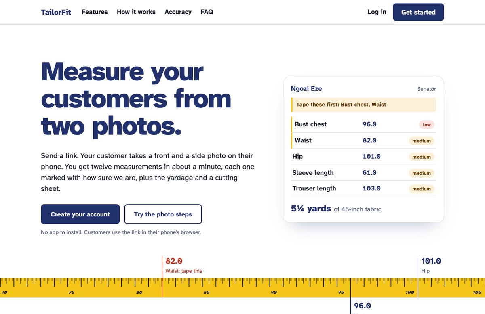
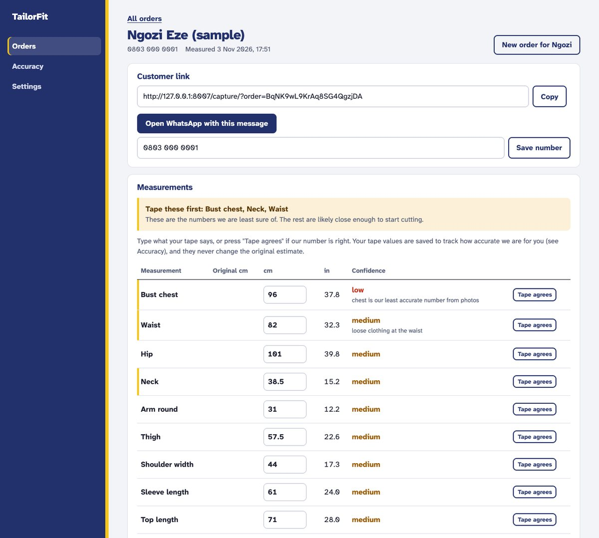
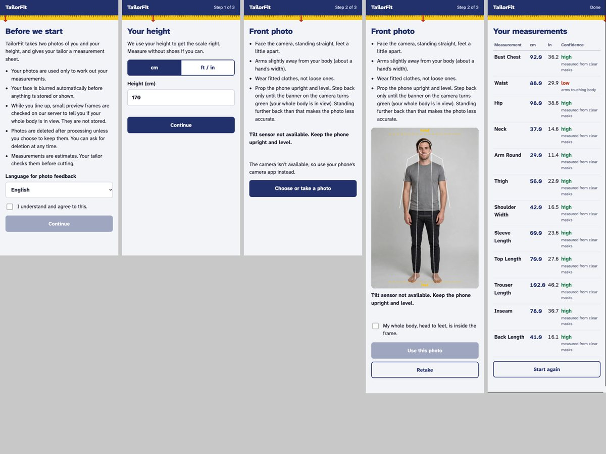
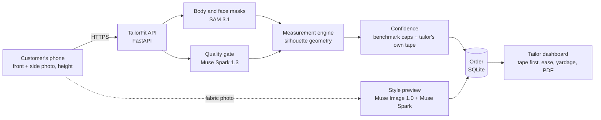

# TailorFit

**Measure your customers from two photos.** A tailor sends a link; the customer takes a front and a side photo on their phone and enters their height; the tailor gets twelve measurements, each marked with how sure we are, plus finished garment sizes, the yardage and a printable cutting sheet.

Built on Meta's models (SAM 3.1, Muse Spark, Muse Image) for **Meta's Build for Your World hackathon, Startup track**.



> **Live demo:** _add the deployed address here_ · **Demo login:** `demo@tailorfit.app` (password in the submission form)

---

## The problem

In Nigeria, and across much of Africa, clothes are still made to measure. A tailor needs a customer's numbers before cutting, and that usually means a trip to the shop, or a relative with a tape and a WhatsApp voice note. Numbers go missing or come back wrong, a customer abroad can't be measured at all, and every mistake costs cloth that was bought by the yard.

Body-measurement apps exist, but they give you one confident-looking number per measurement and leave you to find out at the fitting whether it was right. A tailor can't cut from a number they can't trust.

## What TailorFit does

| For the tailor | For the customer |
| --- | --- |
| Add a customer, send them a private link on WhatsApp | Open the link in the phone's browser; nothing to install |
| See twelve measurements arrive, each marked high, medium or low | The camera says when the whole body is in view, then a timer takes the photo |
| **"Tape these first"**: the two or three numbers worth checking | Add a photo of their fabric to see the style in it |
| Finished garment sizes with editable ease, for 13 styles | Faces are blurred; photos are deleted after processing |
| Yardage for 36, 45 and 60-inch cloth, and a cutting sheet PDF | Can delete their photos from their own link at any time |



### What makes it different

- **Honest numbers.** Every measurement carries a confidence mark that is capped by its measured error on a public benchmark, so nothing is called "high" that we know is often off. The order page tells the tailor which numbers to tape first, which turns "is AI accurate enough?" into "tape three numbers instead of twelve".
- **It gets more accurate the more a tailor uses it.** Whatever the tailor's tape says is stored beside our estimate. The Accuracy page shows each tailor how far off we were for *their* customers, and once a measurement has a steady bias over six orders, new sheets are corrected for it.
- **Made for the work, not just the body.** Thirteen styles: agbada, senator, kaftan, buba and sokoto, gown, mermaid gown, iro and buba, bubu, skirt and blouse, jumpsuit, dashiki, shirt and trousers. Each has its own ease, finished sizes and fabric pattern.
- **Returning customers in seconds.** A repeat order starts from the customer's last numbers (their taped ones where available), and shows what changed when they send new photos.
- **Built for phones in Nigeria.** Works in the browser over a link sent on WhatsApp, guides the customer on the camera screen, supports the phone's wide lens so they don't have to stand far away, and offers photo feedback in Pidgin (draft).



---

## How it works



1. **Quality gate.** Muse Spark rates each photo for loose clothing, posture, arms against the body, lighting, something in the way, the whole body in view and phone tilt, and refuses unusable ones with a plain message in English or Pidgin.
2. **Segmentation.** SAM 3.1 returns the person's mask and the face mask for each photo. The face is blurred before anything is stored or shown.
3. **Measurement.** The front and side silhouettes are scaled by the customer's height. Widths and depths are read at body landmarks found in the outline (armpit, shoulder corner, waist, hip, crotch) and turned into girths with a cross-section shape fitted on a public benchmark.
4. **Confidence.** Each number's score combines mask quality, the photo verdict, whether front and side agree, and its typical benchmark error. Learned offsets from the tailor's own tape values are applied here.
5. **Style and fabric.** The fabric calculator lays out each style's pieces on 36, 45 or 60-inch cloth. Muse Image draws the chosen style in the customer's fabric, checked by Muse Spark for body proportions and labelled "Preview, not the final garment".

### Meta models used

| Model | Used for | Why this model |
| --- | --- | --- |
| **SAM 3.1** | Person and face masks from each photo; live "whole body in view" hints while the customer lines up | Clean, full-body masks are what the geometry needs; the same model finds the face to blur |
| **Muse Spark 1.3** | Photo quality gate; judging the style preview | Fast multimodal reasoning (about 3 s at minimal effort) for yes/no checks with reasons |
| **Muse Image 1.0** | Style preview in the customer's fabric | Edits from the customer's photo and a fabric swatch |

No GPU hosting is needed: everything runs on one small server calling Meta's API.

---

## Accuracy

We measure ourselves on **BodyM**, a public dataset of body scans with front and side silhouettes (by Amazon, CC BY-NC 4.0). Six of our twelve measurements have a BodyM counterpart. The engine was tuned only on **Test-A** (87 people) and then judged on **Test-B** (150 people) that it never saw during tuning.

Mean absolute error, cm, held-out Test-B:

| Measurement | First version | Now |
| --- | --- | --- |
| Shoulder width | 6.2 | **1.9** |
| Arm round | 4.3 | **2.6** |
| Thigh | 8.8 | **5.7** |
| Waist | 8.4 | **6.0** |
| Hip | 6.7 | **6.2** |
| Bust / chest | 14.0 | **6.6** |

What moved the numbers, each found by looking at where the engine failed:

- **Arms merged with the torso** were being measured as chest (+25 cm). The engine now finds where the arms separate.
- **Chest** is now the widest torso in a window below the armpit, because with arms held out the armpit row sits above the fullest part of the chest (10.1 to 6.6 cm).
- **Shoulder width** was reading the arms: the outline keeps widening as the arms join it. The engine now finds the shoulder corner, where the outline stops widening fast (6.2 to 1.9 cm).
- **Cross-sections** use a squarer shape than an ellipse, fitted on Test-A.

**Read it honestly.** BodyM is clean outlines with no clothing, no phone camera and no room light, so it is a best case: real photos will do worse. That is the reason for the confidence marks, "tape these first" and the per-tailor correction loop. Low-confidence labels do line up with larger errors on both test sets. Details, per-set tables and the method are in [eval/README.md](eval/README.md).

### Performance

| Test | Result |
| --- | --- |
| One measurement request | about 3.4 s |
| 50 requests at once, real models, one laptop | 50 of 50 succeeded; median 31 s, slowest 39 s |

---

## Privacy and security

- Faces blurred automatically; photos processed in memory and deleted, unless the customer opts in to the tailor keeping face-blurred copies.
- Each tailor sees only their own customers (every endpoint tested against another tailor's orders).
- Passwords stored as scrypt hashes; sessions are random tokens of which only a hash is stored.
- Uploads re-encoded to strip location and device metadata; JPEG, PNG and WebP only, with size limits.
- Strict Content-Security-Policy, cross-site request checks, rate limits on the costly model calls.

Known gaps are listed openly in [services/api/SECURITY.md](services/api/SECURITY.md).

---

## Run it yourself

Needs **Python 3.12**, **Node 22** and a **Meta Model API key**.

```bash
git clone <this repo> && cd TailorFit
cp .env.example .env          # set MODEL_API_KEY; optionally DEMO_PASSWORD for the demo account

# Python dependencies (one virtual environment for every service)
python3.12 -m venv services/api/.venv
for f in services/*/requirements.txt eval/requirements.txt; do services/api/.venv/bin/pip install -r "$f"; done

# Node package that decodes SAM's masks
(cd services/segmentation && npm ci)

# Start
cd services/api && .venv/bin/python -m uvicorn app.main:app --host 0.0.0.0 --port 8000
```

Open `http://localhost:8000`, click **Get started**, create an account, add a customer and open their link on your phone. The camera needs HTTPS on a phone, so test from a phone through an HTTPS tunnel (for example `cloudflared tunnel --url http://localhost:8000`). Without a model key the API runs with clearly marked demo numbers (`TAILORFIT_STUBS=1` forces this).

### Tests

430 automated tests across nine suites, run in CI on pushes to `main` and on pull requests:

```bash
PY=$PWD/services/api/.venv/bin/python
for d in services/api services/measurement services/segmentation services/quality-gate \
         services/confidence services/style-preview services/fabric-calculator eval; do
  (cd $d && $PY -m pytest -q); done
(cd apps/web/capture && node --test tests/logic.test.js)
```

Reproduce the benchmark: `python scripts/fetch_bodym.py --split testB --subjects 150`, then `python scripts/evaluate.py bodym --split testB --subjects 150`.

---

## Project structure

| Path | What it is |
| --- | --- |
| `apps/web/landing` | Marketing page |
| `apps/web/capture` | Customer photo steps (plain HTML and JS, no build) |
| `apps/web/dashboard` | Tailor app: orders, accuracy, settings |
| `apps/web/shared` | Design tokens, font, the tape-measure motif |
| `services/api` | FastAPI app: accounts, orders, security, PDF, WhatsApp links |
| `services/quality-gate` | Muse Spark photo checks |
| `services/segmentation` | SAM 3.1 masks, face blur, framing |
| `services/measurement` | Silhouette geometry: twelve measurements |
| `services/confidence` | Confidence scores and calibration from tape values |
| `services/style-preview` | Style catalogue and Muse Image previews |
| `services/fabric-calculator` | Pattern pieces, ease, finished sizes, yardage |
| `packages/contract` | JSON Schema shared by every service |
| `eval` | Benchmark harness, pilot scoring, results |

---

## Limitations

- Accuracy figures come from clean benchmark outlines; a pilot with real customers and a tailor's tape is the next step.
- Six measurements (neck, sleeve, top, trouser and back length, inseam) have no benchmark counterpart yet, so they are capped at medium.
- The fabric patterns and default ease for the 13 styles are first estimates of standard cuts, to be confirmed by tailors.
- No password reset yet (needs email or SMS); the Pidgin text needs a native speaker's review.
- Automatic WhatsApp sending (Cloud API) is built but not yet tested against a real WhatsApp Business account; the "Open WhatsApp" button works today.

## What's next

1. **Pilot** with tailors in Lagos: real orders with tape values, to replace benchmark figures with real ones.
2. **WhatsApp-first flow**: customers message the shop's number and get their link back.
3. **Shop tools**: deposits, fitting dates and order status messages, so TailorFit becomes the tailor's order book.
4. **More styles and fabrics**, added with tailors, plus pattern export.

---

## Credits

- Meta: SAM 3.1, Muse Spark 1.3, Muse Image 1.0; masks decoded with `@meta-sam/parser` (SAM License).
- BodyM dataset by Amazon (CC BY-NC 4.0), used for evaluation only.
- Atkinson Hyperlegible Next, from the Braille Institute (SIL Open Font License).
